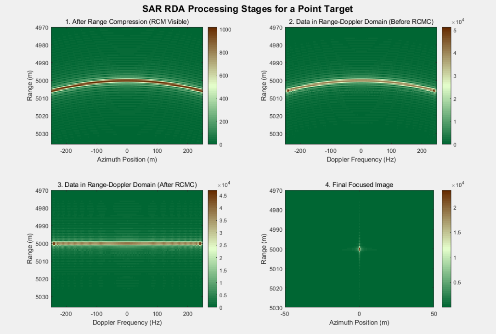

# [SAR Imaging] Synthetic Aperture Radar (SAR) Distance Doppler Algorithm (RDA) Point Target Imaging: From Theory to Focusing [with MATLAB Code]

I. System and Geometric Parameters: Fundamental Definition of Imaging
1. Basic electromagnetic and emission signal parameters•
Light speed: (The speed of electromagnetic waves propagating in vacuum);
•  
Carrier Wavelength: Determined by the carrier frequency (e.g., for C-band).
•  
Linear Frequency Modulation (LFM) signal: Transmitted signal bandwidth, pulse width, chirp rate (rate of frequency change) (characterizing the modulation slope of LFM signals).
2. Objective - Platform Geometric Parameters
Recent slant range: The shortest distance between the target and the platform trajectory (the baseline distance for point-target imaging);
•  
Platform speed: (determines the formation rate of the synthesis aperture);
•  
Synthetic Aperture Length: (The distance of the platform moving during the coherent accumulation time);
•  
Aperture time: The time that the platform takes to sweep through the synthesized aperture;
•  
Pulse Repetition Frequency (PRF): (determines the azimuth sampling density);
•  
Azimuth sampling number: (take even numbers to simplify FFT phase alignment);
•  
Slow time: The time axis describing the platform motion (covering the entire swath time).
3. Distance-based sampling parameters•
Maximum slant range (distance of motion limit): The target's slant range when the platform moves to the two ends of the aperture.
•  
Fast time: the time range of the backscatter signal (ensuring complete capture of earliest / latest backscatter);
•  
Resolution distance: Determined by the LFM signal bandwidth (the wider the bandwidth, the higher the resolution);
•  
Range Change Moment (RCM): The change in target range with platform motion, which can be converted into distance units.
II. Point Target Raw Backscatter: Construction of Signal Model During the Process of SAR Platform Movement, The Instantaneous Transverse Range of the Target Changes with Slow Time:
The round-trip time of the echo is the time it takes for an electromagnetic wave to travel back and forth to the target:
The received LFM echo signal must satisfy the condition "non-zero only during the pulse duration", therefore a rectangular window is introduced (time=1, otherwise=0):
Since the SAR system usually processes signals at baseband, it needs to modulate the carrier phase (remove the carrier frequency component):
In the formula, it reflects the phase accumulation of the carrier's round-trip propagation.
III. Distance Compression: The essence of focusing on distance-to-energy compression is to perform matched filtering on LFM signals—using a filter that is conjugate with the transmitted signal, which compresses the spread pulse into a narrow pulse, enhancing the resolution in the direction of distance.
1. The design of the matched filter in the time domain reference LFM signal is consistent with the transmitted signal:
To adapt to the fast time sampling length, zero-padding the reference signal and then performing FFT is required, followed by taking the conjugate to obtain the frequency domain matching filter.
2. Frequency domain implementation of distance compression According to the convolution theorem, time-domain matching filtering is equivalent to frequency-domain multiplication:
1  
Perform a distance-domain FFT on the original echoes, converting to distance domain: Distance
Leave
To
;   
2  
Frequency-domain multiplication matched filter:
3  
Inverse FFT conversion back to the time domain, obtaining distance compression results:
Leave
To
.  
After distance compression, the target is focused in the distance direction but still exhibits "slanted lines" dispersion in the azimuth direction due to range-dependent motion (RCM) —— this is the result of platform movement causing the target's slant range to vary with azimuth.
IV. Doppler Domain Transformation: Frequency Representation in Azimuth Direction for Data Compression - Apply an azimuth-direction Fast Fourier Transform (FFT) to the data after distance compression, and align the frequency axis center by using the FFTshift function, resulting in the Doppler Domain (RD) signal.
Fang
Bits
To
The Doppler frequency axis in the RD domain is defined as:
Doppler frequency and platform - relative motion velocity of the target: zero Doppler corresponds to the moment when the platform is closest to the target, positive Doppler corresponds to the stage when the platform approaches / leaves the target.
V. Distance Moment Correlation (RCMC): Elimination of Azimuth-Range Coupling in the RD domain, where Doppler frequency and target range are subject to a definite relationship, thus distance moment correlation can be computed for each Doppler frequency bin, and RCM can be eliminated through interpolation:
1. The Doppler-dependent distance motion model is derived from the geometric relationship between the Doppler frequency and the slant range, resulting in the distance motion momentum:
At that time, the Doppler frequency exceeded the physical range, and the signal was set to zero.
2. Interpolation correction maps the original distance grid to the corrected grid for each Doppler frequency bin, resulting in signals processed by RCMC. After correction, the energy of the target in the RD domain will converge into a "horizontal line," eliminating the coupling between azimuth and distance.
VI. Azimuth Compression: Focusing on the azimuthal energy, a similar approach to matching filtering is used, utilizing the relationship between Doppler frequency and azimuthal phase in the RD domain to design the filter.
The response of the azimuth matched filter is:
(Valid only at that time, otherwise set to zero)
Multiply the data after RCMC with the directional matching filter to achieve directional frequency domain focusing:
VII. Azimuth Inverse FFT: Generate the final focused image pair by performing an IFFT shift (inverse frequency shift) on the data after azimuth compression in the RD domain, followed by an azimuth-domain IFFT to convert back to "distance - azimuth domain".
Fang
Bits
To
In the final imaging results, the energy of point targets is focused in both distance and azimuth directions. The resolution in the distance direction is determined by the aperture length, while the resolution in the azimuth direction is determined by the aperture angle. The final image presents as clear "point" shapes.
Summary: The core logic of RDA is to solve the problem of distance-azimuth coupling in SAR imaging through "domain processing".
1  
Distance compression focusing distance to energy;
2  
RD domain transformation converts the azimuth direction to the frequency domain, decoupling distance and azimuth.
3  
RCMC eliminates distance shift, aligning target energy in RD domain;
4  
Azimuth compression focuses azimuthal energy;
5  
Generate the final image using inverse FFT.
This process fully utilizes the efficiency of FFT, which is a classic solution for real-time imaging in SAR and also an essential foundation for understanding the principles of SAR imaging.
End

## Images

<!-- PAYMENT_BLOCK -->

## Get this dataset

- Payment link (Stripe): [Buy now](https://buy.stripe.com/3cs8yP7sY87d0vu9AB)
- Payment QR code: 

<!-- /PAYMENT_BLOCK -->
